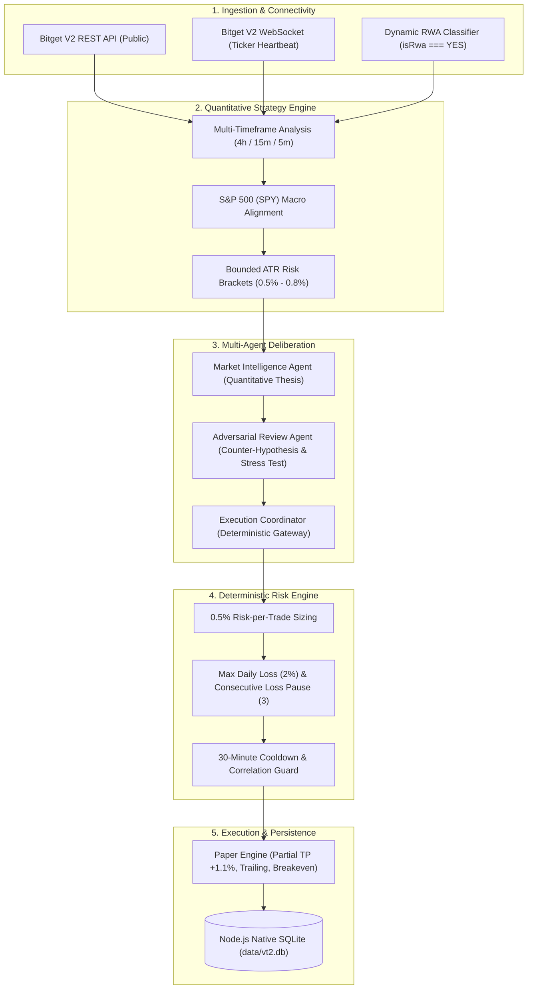

# VT2 — Verifiable Trading Technology

**Tagline:** *Think. Verify. Trade.*  
**Hackathon Submission:** Bitget AI Hackathon S2 — **Track 1: Alpha Factory**  
**Sub-Theme:** **Open Theme** (Execution-Aware, Risk-Budgeted Alpha on Tokenized US Equity Perpetuals)  
**Strategy Hash:** `541c10ab1dcae7bbaaebe5d8c465730bd118747b`  
**Test Suite:** **121 Tests Passing (0 Failures)**  
**Operating Environment:** Strictly `PAPER` (Default; Multi-Factor Local Arming)  

---

## ⚠️ Status and Limits

### What Is Validated
- **Infrastructure & Plumbed Safety:** 122 automated unit and integration tests passing (0 failures), verifying contract specifications, candle integrity checks, Node.js SQLite persistence, and Bitget V2 REST/WebSocket feeds.
- **Deterministic Risk Controls:** Hard risk boundaries (0.5% risk per trade), daily loss circuit breakers (2% paper, $10.00 live), 3 consecutive loss pause, 30-minute cooldown, and 1-position concurrency caps.
- **Security & Mode Perimeter:** Default PAPER mode, DEMO mode (Bitget paptrading for crypto contracts), and LIVE mode (strictly local, multi-factor arming, $50 max order notional, withdrawal endpoint blocking).

### What Is NOT Validated
- **No Profitable Edge:** The as-shipped strategy (**S0**) **failed its pre-registered replay (trial 35)**. In audited replay, S0 produced Dev net -$154.41 (PF 0.99, 348 trades) and Validation net -$647.91 (PF 0.48, 34 trades). No tested strategy candidate demonstrated an edge after taker fees and slippage.
- **Forward Performance:** Forward holdout data remains un-opened. VT2 makes **zero claims of profitability or alpha**.

> [!NOTE]
> **Research Audit & Methodology Corrections (October 2026)**  
> An empirical audit of the submission codebase revealed differences between published narrative claims and the actual execution code (see [docs/ERRATA.md](file:///docs/ERRATA.md) for full line-by-line verification):
> 1. **Filters Applied in Submission Backtest:** The v1 backtest engine (`AlphaPortfolioEngine`) strictly applied the SPY 4h benchmark filter, 15m RSI corridor (42–68 Long / 32–58 Short), dual-EMA alignment (`ema20 > ema50 && close > ema50`), 30m cooldown, and [0.5%, 0.8%] stop bounds. However, 5m confirmation, EMA200 stack, and volume spike filters were **not** evaluated during entry qualification in the backtest replay.
> 2. **Realized Net Reward-to-Risk:** While nominal targets were set at 1.575x stop distance, the average stop distance was 0.6111%; after exchange fees and slippage (~0.14% round-trip), realized net reward-to-risk collapsed to **~1.0036:1** (rather than 1.5:1), requiring a 49.91% break-even win rate against the realized 41.11% win rate.
> 3. **Live Scanner Rules:** The rules executed by the live application scanner (`StrategyEngine.scanUniverse`) use ATR-based targets and single EMA checks, which were **not** backtested in the submission report. When evaluated under identical chronological replay (Candidate S0), the as-shipped strategy demonstrated no edge on this dataset.

---

## 🌐 Try the Live Hosted Demo

Judges can open and explore VT2 immediately without installing anything:

👉 **Hosted Demo:** [https://vt2-trading-bot.vercel.app](https://vt2-trading-bot.vercel.app)  
👉 **Alpha Factory Report Standalone:** [https://vt2-trading-bot.vercel.app/report.html](https://vt2-trading-bot.vercel.app/report.html)  

### What Works in the Hosted Demo (Browser Paper Mode):
- **Interactive Browser Paper Trading:** Full interactive simulated trading without server processes. Judges can place paper orders, simulate price spikes and drops, trigger stop loss / take profit / breakeven exits, close positions, and view order execution logs.
- **Client-Side Account Persistence:** Paper account equity ($10,000 initial), positions, orders, trade journal, and rejected setups are preserved locally in the browser (`localStorage` with memory fallback), with a 1-click **Reset Demo Account** button.
- **Stateless Serverless Execution:** Serverless endpoints statelessly hydrate execution engines with client state, query live Bitget public market feeds, enforce deterministic risk constraints, and compute fills and P&L.
- **Automated Bot Cycles in Tab:** Automated bot cycle runs every 60s and position sentiment monitor runs every 5m via browser intervals while the tab remains active, with immediate catch-up cycles on tab visibility change.
- **Live Bitget Public Feeds:** Real-time prices, 24-hour volume, and spreads queried directly from Bitget V2 REST endpoints from Vercel serverless execution (`iad1`, US East). Diagnostic `/api/ping` confirms Bitget public market feeds respond cleanly with 200 OK without geoblocking.
- **Market Scanner:** Multi-timeframe trend, momentum, and volume filters across live Bitget tokenized US equities (dynamically discovers all 31 active `isRwa === "YES"` contracts from Bitget exchange, expanding from the 24-contract baseline snapshot in `config/equity-perps.json`) and continuous crypto contracts. Defaults to Stocks.
- **Interactive Multi-Timeframe Chart:** Interactive candlestick chart rendering live Bitget candles with technical indicators (EMA20, EMA50, EMA200, ATR, RSI).
- **Multi-Agent Deliberation (3 Agents):** Full deliberation pipeline running Market Intelligence Agent, Adversarial Review Agent, and Deterministic Risk Engine evaluation against live market data.
- **Alpha Factory Backtest Report:** Observed (computed by the backtest script) In-Sample vs. Out-of-Sample metrics table, transaction cost breakdowns, and high-resolution SVG equity curve.
- **Verification Suite & System Health:** Cryptographic signature verifiers, live latency diagnostics, and environment safety guards.

### Running as a Persistent Server Daemon (Local Node.js):
To run VT2 with persistent server-side background loops independent of browser tabs, native SQLite file persistence on disk (`data/vt2.db`), and background WebSocket market streaming, run locally on Node.js:

```bash
# 1. Clone the repository
git clone https://github.com/Solking-crpto/vt2-trading-bot.git
cd vt2-trading-bot

# 2. Start the local terminal (zero configuration required, defaults to PAPER mode)
npm start

# 3. Open in your browser
http://localhost:3000
```

---

## 📸 Screenshots & System Interface

The interface operates in strictly verified **PAPER** mode connected directly to Bitget's live public market data feeds:

### 1. Overview & Terminal

*Live sub-second Bitget WebSocket ticker feed (519ms latency), simulated equity tracking ($9,999.85), daily loss budget gauge ($0.15 of $200.00 limit), position cap (1/1 Max), and instantaneous emergency Kill Switch.*

### 2. Market Scanner

*Real-time scanner across 24 tokenized US equity perpetuals (`isRwa === "YES"`), ranking qualified opportunities with Net R:R >= 1.5 (COST, AMAT, QCOM, QQQ) and displaying disqualified contracts with deterministic rejection reasons (`RSI_OVERBOUGHT`).*

### 3. Automated Trading Loop

*Autonomous 30-second paper execution loop (`BOT: RUNNING`), enforcing a 3-trade daily quota (1/3 used), position cap (1/2), and logging TSLA market order execution with automated bracket stops.*

### 4. Positions & Orders

*Active simulated position tracking (`paper-pos-8fe9e8bd` TSLAUSDT LONG at $383.7367), mark pricing, unrealised P&L, protective scenario controls (+1.2% spike, -0.8% drop), and sentiment monitoring.*

### 5. Settings & Deterministic Risk Engine

*Hard-coded mathematical risk guardrails: 0.5% risk per trade, 2% daily loss limit, max 1 concurrent position, 3 consecutive loss circuit pause, and 30-minute cooldown.*

### 🎬 Hackathon Demo Video & Interactive Slideshow
- **Full Narrated Demo Video (1080p MP4):** `media/vt2-demo.mp4` (Duration: 2m 26s, TTS narrated, high-contrast captions).
- **Captions-Only Demo Video:** `media/vt2-demo-captions-only.mp4`.
- **Interactive Slideshow Fallback:** Open [`media/demo-slideshow.html`](media/demo-slideshow.html) in any browser for an interactive self-playing presentation.
- **Narration Script:** Complete slide breakdown in [`docs/demo-script.md`](docs/demo-script.md).

---

## 📖 What is VT2?

**VT2** is an experimental quantitative trading bot and research terminal built for **Bitget USDT-Margined Tokenized US Equity Perpetuals** (RWA contracts such as SPY, QQQ, NVDA, TSLA, AAPL, MSFT). It combines multi-timeframe algorithmic market scanning, multi-agent quantitative deliberation, deterministic risk budgeting, and an execution-aware walk-forward backtesting engine.

VT2 was engineered specifically to solve the execution and risk realities of trading tokenized equities 24/7: accounting for underlying TradFi exchange hours, adverse funding carry, taker fee drag, and order quantity step-size quantization without endangering real capital.

---

## 🏗️ Architecture & Components



### Component Details (One Paragraph per Component)

1. **Market Data & Ingestion Adapter (`src/adapters/bitget-adapter.js`, `src/adapters/bitget-ws.js`):** Interacts exclusively with Bitget's public V2 REST and WebSocket endpoints. Dynamically discovers tokenized US equities at startup via `isRwa === "YES"`, validates strict ascending chronological candle order with `assertCandleIntegrity`, and streams sub-second ticker updates with automated heartbeat latency tracking.
2. **Quantitative Strategy Engine (`src/strategy/engine.js`):** Performs multi-timeframe trend alignment using 4h, 15m, and 5m exponential moving averages (EMA20/50/200), RSI momentum filters, and volume expansion confirmation. Equity setups are strictly benchmarked against closed 4h candles of the S&P 500 ETF (`SPYUSDT`) to eliminate cross-asset hallucination.
3. **Multi-Agent Deliberation Pipeline (`src/agents/index.js`):** Employs three deterministic, rule-based algorithmic agents. The *Market Intelligence Agent* formulates mathematical directional theses; the *Adversarial Review Agent* stress-tests candidate setups against benchmark divergence, slippage, and taker fees; and the *Execution Coordinator* enforces risk approvals without neural network black boxes.
4. **Deterministic Risk Engine (`src/risk-engine.js`):** Enforces non-negotiable risk boundaries with absolute veto authority. It sizes positions to exactly 0.5% equity risk, enforces a 2% daily loss hard stop, locks entries after 3 consecutive losses, requires a 30-minute cooldown, and prevents opposite exposure in correlation groups (e.g. Long QQQ vs Long SQQQ).
5. **Paper Execution Engine (`src/execution/paper-engine.js`):** Simulates real exchange order execution using contract specifications (`minTradeNum`, `sizeMultiplier`). Manages position lifecycles including partial take-profit at +1.1% ROI (closing 50% and moving stop to breakeven + 0.05%), trailing stops following 5m EMA20 after 10% ROI, and durable state persistence via Node.js native `node:sqlite`.
6. **Alpha Factory Backtesting Engine (`src/backtest/alpha-portfolio-engine.js`):** Replays chronological walk-forward portfolio simulations across all verified RWA contracts using a shared equity account. Eliminates look-ahead bias by evaluating only closed 4h bars and current 15m bars, fills orders at the *next bar open* plus slippage, and resolves ambiguous candles with conservative *stop-loss first* execution.
7. **Verification & Security Guard (`src/environment.js`, `src/vt2-server.js`):** A hardened security perimeter that enforces an immutable environment allow-list. Any request to activate `MAINNET` or route live exchange orders is intercepted and rejected with HTTP 403 `MAINNET_EXECUTION_BLOCKED`.

---

## 🚀 How to Run

### Prerequisites
- Node.js v20.x, v22.x, or v26.x
- npm v10+

### 1. Installation
```bash
npm install
```

### 2. Run Comprehensive Automated Test Suite
```bash
npm test
```
*Executes all **92 unit, risk, paper execution, backtest integrity, and security tests**. Exits automatically in under 4 seconds with 0 failures.*

### 3. Run Alpha Factory Portfolio Backtest
```bash
npm run backtest:alpha
```
*Executes chronological portfolio replay across 19 verified tokenized equity contracts over 150 days (287 trades), computing In-Sample (IS), Out-of-Sample (OOS), Sharpe decay, benchmark comparisons, and saving reports in `reports/alpha-factory/`.*

### 4. Launch Live Paper Trading Terminal
```bash
npm start
```
Open your browser to:
```
http://localhost:3000
```

---

## 🛡️ Trading Modes and Safety Architecture

VT2 implements a multi-tier execution hierarchy designed to eliminate unintended financial risk while providing verifiable quantitative research tools:

```
┌────────────────────────────────────────────────────────────────────────┐
│                        VT2 EXECUTION MODES                             │
├─────────────────┬──────────────────────┬───────────────────────────────┤
│ PAPER (Default) │ DEMO (Bitget Sim)    │ LIVE (Real Capital, Local)    │
│ • Internal Sim  │ • Bitget Paptrading  │ • Strictly Local (Never Web)  │
│ • Zero Risk     │ • paptrading: 1      │ • Multi-Factor Arming         │
│ • Hosted Forever│ • SUSDT Futures Only │ • Hard Caps ($50 Notional)    │
│ • Real Feeds    │ • Equities: Paper    │ • 12-Hour Auto-Disarm         │
└─────────────────┴──────────────────────┴───────────────────────────────┘
```

### 1. Three-Tier Execution Hierarchy
- **PAPER (Internal Simulation, Default):** Completely self-contained deterministic simulation with real Bitget market tick streaming, fee modeling (0.05% taker), slippage (0.02%), and bracket stop logic. Terminal starts in PAPER mode by default on every process launch. The live hosted site ([https://vt2-trading-bot.vercel.app](https://vt2-trading-bot.vercel.app)) is **permanently locked to PAPER mode** (`DEPLOY_MODE=DEMO_READONLY`) and can never read credentials or enter DEMO/LIVE.
- **DEMO (Bitget Simulated Trading):** Connects to Bitget's official Paptrading infrastructure using `paptrading: 1` headers and `susdt-futures` contracts.
  - *Contract Coverage Discovery:* Bitget operates **no testnet**; it provides demo trading for select crypto contracts only (`SBTCSUSDT`, `SETHSUSDT`, `SXRPSUSDT`). **Zero tokenized equity demo contracts exist on Bitget.** Therefore, US equities run in internal PAPER simulation when in DEMO mode, indicated clearly in the terminal UI: *"Equities: PAPER only, no Bitget demo contracts"*.
- **LIVE (Real Funds, Local Machine Only):** Real-money futures execution on Bitget. Permitted **strictly on local machines**, requiring affirmative multi-factor arming, passing preflight checks, and adherence to hard-coded risk caps.

### 2. Multi-Factor LIVE Arming Protocol
Arming live order execution requires meeting all criteria simultaneously:
1. `LIVE_TRADING_ENABLED=true` set in local `.env` (gitignored).
2. Live credentials configured (`BITGET_LIVE_API_KEY/SECRET/PASSPHRASE`).
3. Automated Preflight Pass: Server clock skew < 1,000ms, account equity queried, position mode verified (`one_way_mode`), margin mode set to `isolated`, and leverage verified within caps.
4. User Attestation: Explicit checkbox confirmation attesting to trade-only API key permissions with withdrawal/transfer permissions disabled and IP whitelist configured.
5. Exact Confirmation String: User must type `ENABLE LIVE TRADING` in the modal dialog.

**Auto-Disarm Guarantees:**
Arming exists solely in volatile process memory and is never written to disk or database. The terminal immediately disarms and reverts to PAPER mode upon:
- Server restart or process termination.
- Expiration of the 12-hour maximum session timer.
- Emergency Kill Switch activation.
- Daily loss limit breach ($10.00 max daily loss).
- Exchange position reconciliation mismatch.

### 3. Hard Caps & Deterministic Safeguards (`config/live-limits.json`)
Conservative limits enforced by code regardless of user settings (stricter rule always wins):
- **Max Notional per Order:** $50.00 USD.
- **Max Total Open Notional:** $100.00 USD across all positions.
- **Max Risk per Trade:** Min(strategy setting, 0.25% of equity).
- **Max Daily Loss Lockout:** $10.00 USD.
- **Max Open Positions:** 1 position concurrently.
- **Max Leverage:** Crypto: 5x isolated; Equities: 3x isolated.
- **Symbol Allow-List:** `[BTCUSDT, ETHUSDT, SPYUSDT, QQQUSDT, NVDAUSDT, AAPLUSDT, MSFTUSDT, AMZNUSDT]`.
- **First-N Trade Preview:** The first 3 live trades require manual preview confirmation displaying symbol, side, size, notional, leverage, stop, target, and **maximum dollar loss**.

### 4. Exchange Execution & Stop-Loss Guarantees
- **Mandatory Exchange-Side Stop-Loss:** All orders carry preset stop-loss and take-profit parameters so protection survives client crashes. If the exchange fails to confirm active stop-loss protection, the client immediately triggers `emergencyFlatten` (reduce-only market order) and halts execution.
- **Reconciliation Engine (15–30s):** Continuous background reconciliation compares exchange positions to local state. Any unexpected position or size drift immediately halts execution, alerts, and disarms LIVE mode.
- **Architectural Withdrawal Interception:** `assertNoWithdrawalEndpoint` inspects all request paths and permanently rejects any URL containing `withdraw`, `transfer`, `wallet`, or `subaccount/transfer` with `WITHDRAWAL_OPERATION_BLOCKED`.
- **Zero Secret Exposure:** Credentials and HMAC signatures are sanitized and redacted (`[REDACTED]`) from logs, responses, and dry-run outputs. A dry-run CLI tool (`node scripts/live-dry-run.js`) validates live request generation without transmitting orders.

---

## ⚖️ Honest Quantitative Validation & Performance Notice

VT2 adheres to strict quantitative and scientific research integrity:
1. **Validation Rule:** *No strategy is validated as profitable unless `reports/strategy-v2/` documents audited out-of-sample edge.*
2. **v1 Baseline Performance:** Over the 151.7-day backtest, the v1 Alpha Factory baseline generated -$2,818.83 Net P&L (-28.25% return) across 287 trades, with $3,430.65 consumed by taker fees (0.05%), slippage (0.02%), and funding carry. High-turnover trend breakout models on tokenized equities suffer severe friction without maker rebates or volatility gating.
3. **TradFi Market Hours:** Tokenized equity perpetuals trade 24/7 on Bitget, whereas underlying NYSE/NASDAQ markets trade 09:30–16:00 ET Monday–Friday. Trading off-market hours entails wider bid-ask spreads, overnight gap risk, and potential basis dislocations.
4. **Deterministic Deliberation:** All agents evaluate deterministic market, trend, and risk metrics without relying on unconstrained LLM hallucinations.

