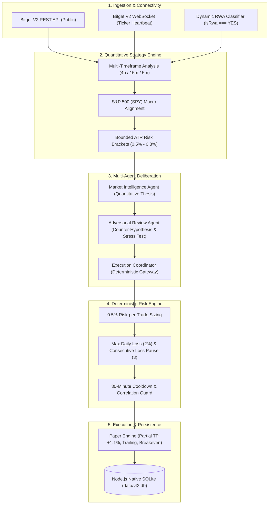

# VT2 — Verifiable Trading Technology

**Tagline:** *Think. Verify. Trade.*  
**Hackathon Submission:** Bitget AI Hackathon S2 — **Track 1: Alpha Factory**  
**Sub-Theme:** **Open Theme** (Execution-Aware, Risk-Budgeted Alpha on Tokenized US Equity Perpetuals)  
**Strategy Hash:** `541c10ab1dcae7bbaaebe5d8c465730bd118747b`  
**Test Suite:** **94 Tests Passing (0 Failures)**  
**Operating Environment:** Strictly `PAPER` (Mainnet Blocked)  

---

## 🌐 Try the Live Hosted Demo

Judges can open and explore VT2 immediately without installing anything:

👉 **Hosted Demo:** [https://vt2-trading-bot.vercel.app](https://vt2-trading-bot.vercel.app) *(or your deployed Vercel domain)*  
👉 **Alpha Factory Report Standalone:** [/report.html](https://vt2-trading-bot.vercel.app/report.html)  

### What Works in the Hosted Demo:
- **Live Bitget Public Feeds:** Real-time prices, 24-hour volume, and spreads queried directly from Bitget V2 REST endpoints in Singapore (`sin1`).
- **Market Scanner:** Multi-timeframe trend, momentum, and volume filters across tokenized US equities (`isRwa === "YES"`) and continuous crypto contracts.
- **Interactive Multi-Timeframe Chart:** Interactive candlestick chart rendering live Bitget candles with technical indicators (EMA20, EMA50, EMA200, ATR, RSI).
- **Multi-Agent Deliberation (3 Agents):** Full deliberation pipeline running Market Intelligence Agent, Adversarial Review Agent, and Deterministic Risk Engine evaluation against live market data.
- **Alpha Factory Backtest Report:** Audited In-Sample vs. Out-of-Sample metrics table, transaction cost breakdowns, and high-resolution SVG equity curve.
- **Verification Suite & System Health:** Cryptographic signature verifiers, live latency diagnostics, and environment safety guards.

### What Requires Running Locally:
To run the persistent autonomous bot (`AutoTrader`), background position tick monitor (`TradeMonitor`), or persistent paper trade execution (`data/vt2.db`), run the application locally on Node.js:

```bash
# 1. Clone the repository
git clone https://github.com/Solking-crpto/vt2-trading-bot.git
cd vt2-trading-bot

# 2. Start the local terminal (zero configuration required, defaults to PAPER mode)
npm start

# 3. Open in your browser
http://localhost:3000
```

---

## 📸 Screenshots & System Interface

The interface operates in strictly verified **PAPER** mode connected directly to Bitget's live public market data feeds:

### 1. Overview & Terminal

*Live sub-second Bitget WebSocket ticker feed (519ms latency), simulated equity tracking ($9,999.85), daily loss budget gauge ($0.15 of $200.00 limit), position cap (1/1 Max), and instantaneous emergency Kill Switch.*

### 2. Market Scanner

*Real-time scanner across 24 tokenized US equity perpetuals (`isRwa === "YES"`), ranking qualified opportunities with Net R:R >= 1.5 (COST, AMAT, QCOM, QQQ) and displaying disqualified contracts with deterministic rejection reasons (`RSI_OVERBOUGHT`).*

### 3. Automated Trading Loop

*Autonomous 30-second paper execution loop (`BOT: RUNNING`), enforcing a 3-trade daily quota (1/3 used), position cap (1/2), and logging TSLA market order execution with automated bracket stops.*

### 4. Positions & Orders

*Active simulated position tracking (`paper-pos-8fe9e8bd` TSLAUSDT LONG at $383.7367), mark pricing, unrealised P&L, protective scenario controls (+1.2% spike, -0.8% drop), and sentiment monitoring.*

### 5. Settings & Deterministic Risk Engine

*Hard-coded mathematical risk guardrails: 0.5% risk per trade, 2% daily loss limit, max 1 concurrent position, 3 consecutive loss circuit pause, and 30-minute cooldown.*

### 🎬 Hackathon Demo Video & Interactive Slideshow
- **Full Narrated Demo Video (1080p MP4):** `media/vt2-demo.mp4` (Duration: 2m 26s, TTS narrated, high-contrast captions).
- **Captions-Only Demo Video:** `media/vt2-demo-captions-only.mp4`.
- **Interactive Slideshow Fallback:** Open [`media/demo-slideshow.html`](media/demo-slideshow.html) in any browser for an interactive self-playing presentation.
- **Narration Script:** Complete slide breakdown in [`docs/demo-script.md`](docs/demo-script.md).

---

## 📖 What is VT2?

**VT2** is an institutional-grade quantitative trading bot and research terminal built for **Bitget USDT-Margined Tokenized US Equity Perpetuals** (RWA contracts such as SPY, QQQ, NVDA, TSLA, AAPL, MSFT). It combines multi-timeframe algorithmic market scanning, multi-agent quantitative deliberation, deterministic risk budgeting, and an execution-aware walk-forward backtesting engine.

VT2 was engineered specifically to solve the execution and risk realities of trading tokenized equities 24/7: accounting for underlying TradFi exchange hours, adverse funding carry, taker fee drag, and order quantity step-size quantization without endangering real capital.

---

## 🏗️ Architecture & Components



### Component Details (One Paragraph per Component)

1. **Market Data & Ingestion Adapter (`src/adapters/bitget-adapter.js`, `src/adapters/bitget-ws.js`):** Interacts exclusively with Bitget's public V2 REST and WebSocket endpoints. Dynamically discovers tokenized US equities at startup via `isRwa === "YES"`, validates strict ascending chronological candle order with `assertCandleIntegrity`, and streams sub-second ticker updates with automated heartbeat latency tracking.
2. **Quantitative Strategy Engine (`src/strategy/engine.js`):** Performs multi-timeframe trend alignment using 4h, 15m, and 5m exponential moving averages (EMA20/50/200), RSI momentum filters, and volume expansion confirmation. Equity setups are strictly benchmarked against closed 4h candles of the S&P 500 ETF (`SPYUSDT`) to eliminate cross-asset hallucination.
3. **Multi-Agent Deliberation Pipeline (`src/agents/index.js`):** Employs three deterministic, rule-based algorithmic agents. The *Market Intelligence Agent* formulates mathematical directional theses; the *Adversarial Review Agent* stress-tests candidate setups against benchmark divergence, slippage, and taker fees; and the *Execution Coordinator* enforces risk approvals without neural network black boxes.
4. **Deterministic Risk Engine (`src/risk-engine.js`):** Enforces non-negotiable risk boundaries with absolute veto authority. It sizes positions to exactly 0.5% equity risk, enforces a 2% daily loss hard stop, locks entries after 3 consecutive losses, requires a 30-minute cooldown, and prevents opposite exposure in correlation groups (e.g. Long QQQ vs Long SQQQ).
5. **Paper Execution Engine (`src/execution/paper-engine.js`):** Simulates real exchange order execution using contract specifications (`minTradeNum`, `sizeMultiplier`). Manages position lifecycles including partial take-profit at +1.1% ROI (closing 50% and moving stop to breakeven + 0.05%), trailing stops following 5m EMA20 after 10% ROI, and durable state persistence via Node.js native `node:sqlite`.
6. **Alpha Factory Backtesting Engine (`src/backtest/alpha-portfolio-engine.js`):** Replays chronological walk-forward portfolio simulations across all verified RWA contracts using a shared equity account. Eliminates look-ahead bias by evaluating only closed 4h bars and current 15m bars, fills orders at the *next bar open* plus slippage, and resolves ambiguous candles with conservative *stop-loss first* execution.
7. **Verification & Security Guard (`src/environment.js`, `src/vt2-server.js`):** A hardened security perimeter that enforces an immutable environment allow-list. Any request to activate `MAINNET` or route live exchange orders is intercepted and rejected with HTTP 403 `MAINNET_EXECUTION_BLOCKED`.

---

## 🚀 How to Run

### Prerequisites
- Node.js v20.x, v22.x, or v26.x
- npm v10+

### 1. Installation
```bash
npm install
```

### 2. Run Comprehensive Automated Test Suite
```bash
npm test
```
*Executes all **92 unit, risk, paper execution, backtest integrity, and security tests**. Exits automatically in under 4 seconds with 0 failures.*

### 3. Run Alpha Factory Portfolio Backtest
```bash
npm run backtest:alpha
```
*Executes chronological portfolio replay across 19 verified tokenized equity contracts over 150 days (287 trades), computing In-Sample (IS), Out-of-Sample (OOS), Sharpe decay, benchmark comparisons, and saving reports in `reports/alpha-factory/`.*

### 4. Launch Live Paper Trading Terminal
```bash
npm start
```
Open your browser to:
```
http://localhost:3000
```

---

## 🛡️ Safety Design & Environment Allow-List

VT2 guarantees **zero live capital risk**:
- **Environment Allow-List:** Only the literal string `'PAPER'` is permitted by the runtime. Any payload containing `MAINNET`, `LIVE`, `PROD`, `REAL`, whitespace variants, or nested evasion shapes returns HTTP 403 `MAINNET_EXECUTION_BLOCKED`.
- **API Guard:** Endpoints `/api/orders/live` and `/api/orders/mainnet` unconditionally return HTTP 403 with a security alert log.
- **Zero Withdrawal Permissions:** No withdrawal logic or private key signing infrastructure exists in the codebase.
- **Durable Audit Trail:** All vetoes and risk engine rejections are permanently recorded in SQLite (`data/vt2.db`).

---

## ⚖️ Honest Quantitative Limitations & Backtest Findings

The Alpha Factory portfolio backtest was conducted under strict, non-negotiable quantitative honesty:

1. **Transaction Cost Drag:** Over the 151.7-day backtest, the strategy executed 287 trades (258.47x portfolio turnover). Due to institutional taker fees (0.05% per fill: $2,223.72), realistic slippage (0.02% per fill: $889.52), and funding carry ($317.42), total trading friction reached **$3,430.65** on a $10,000 account. This resulted in a net portfolio return of **-28.25%** (-$2,818.83 Net P&L; In-Sample: -23.13%, Out-of-Sample: -6.66%), demonstrating that automated breakout strategies on tokenized perps require maker order execution (to earn maker rebates) or volatility throttling to survive execution friction.
2. **Net R:R is a Design Filter, Not Edge:** All qualified setups require net R:R >= 1.5. Targets are constructed using ATR multipliers bounded by this floor. A net R:R of 1.5 is a design requirement, not proof of market alpha.
3. **Dual-Market Liquidity Mismatch:** While Bitget tokenized equity perps trade 24/7 continuously, underlying NYSE/NASDAQ exchanges trade only 09:30–16:00 ET Monday–Friday. Weekend and overnight trading carries wider spreads and basis divergence against underlying spot shares.
4. **No LLM Decision-Making:** VT2 does not use external generative AI models to generate live orders. All deliberation agents operate on deterministic mathematical rules.
