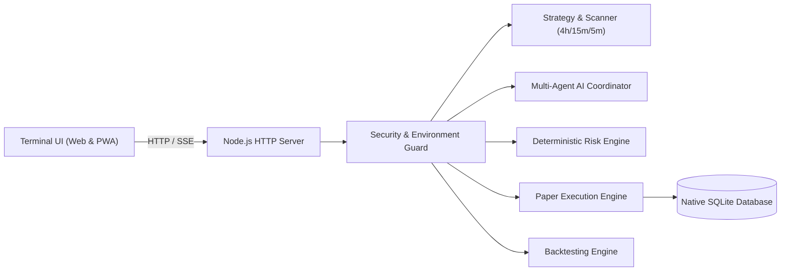

# VT2 — Verifiable Trading Technology

**Tagline:** *Think. Verify. Trade.*

VT2 is a quantitative trading terminal and research platform built for Bitget USDT perpetual markets. It combines multi-timeframe algorithmic market scanning, multi-agent AI deliberation (Market Intelligence & Adversarial Review), and deterministic risk engine enforcement with zero live-capital risk.

---

## ⚡ Key Highlights

- **Strict Paper Trading Only:** Live mainnet order execution is architecturally blocked on both client and server (`MAINNET_EXECUTION_BLOCKED`).
- **Official Bitget Architecture:** Evaluated against official Bitget Agent Hub, `@bitget-ai/bitget-agent-sdk`, and UTA v2/v3 REST endpoints.
- **Deterministic Risk Engine:** Pure code with absolute veto authority over all AI agent recommendations (enforces 0.5% risk/trade, 2% daily loss stop, 3-loss pause, 30m cooldown, min 1.5 net R:R).
- **Multi-Agent Deliberation:** Separates Market Intelligence (thesis generation) from Adversarial Review (thesis destruction) and Deterministic Risk Controls.
- **High-DPI Canvas Charting:** Native responsive candlestick chart with EMA (20/50/200), RSI (14), and Volume overlays.
- **Chronological Walk-Forward Backtester:** Eliminates look-ahead bias and conservatively assumes stop-loss first on ambiguous candles.
- **Durable Persistence:** Uses Node.js v26 native `node:sqlite` (`data/vt2.db`) for durable paper positions, orders, settings, and journal records.
- **Zero Heavy Dependencies:** Starts in milliseconds, runs natively on Node.js 20+ / 22+ / 26+.

---

## 🏗️ Architecture



---

## 🚀 Quick Start

### 1. Run Automated Test Suite
```bash
npm test
```
All **53 automated tests** run and pass across unit, risk, paper execution, backtest, state restore, and Bitget auth signature suites.

### 2. Start VT2 Platform
```bash
npm start
```
Open your browser to:
```
http://localhost:3000
```

---

## 🛡️ Deterministic Risk Engine Policy

The deterministic risk engine (`src/risk-engine.js`) enforces:

| Constraint | Limit |
|---|---|
| Initial Paper Capital | $10,000 USDT |
| Paper Risk per Trade | 0.5% ($50 max risk) |
| Daily Loss Limit | 2.0% ($200 hard stop of start-of-day equity) |
| Consecutive Losses | 3 losses maximum -> Trading Pause |
| Max Open Positions | 1 position concurrent |
| Post-Trade Cooldown | 30 minutes |
| Minimum Net Reward:Risk | 1.5:1 after modeled fees & slippage |
| Research Stop Distance | 0.5% min to 0.8% max distance |
| Signal Freshness | Max 10 minutes |

---

## 🤖 Deterministic Multi-Agent Deliberation System

VT2 uses a transparent, deterministic multi-agent rule architecture (no external LLM required):

1. **Market Intelligence Agent:** Algorithmic rules agent that synthesizes multi-timeframe trend alignment (4h/15m EMA), RSI momentum, and benchmark market regime (SPY for stocks, BTC for crypto) into a directional conviction score.
2. **Adversarial Review Agent:** Quantitative stress-testing agent that evaluates contra-trend volatility, ATR extensions, resistance proximity, and session conditions to formulate explicit counter-theses and apply score penalties.
3. **Multi-Agent Coordinator:** Deterministic rule arbiter that resolves thesis and antithesis, verifies account risk gates (cooldowns, daily loss locks), and issues final approval or veto decisions.
4. **Deterministic Risk Engine:** Mathematical veto authority that enforces hard boundary constraints (0.5% risk/trade, 2% daily loss cap, 3-loss pause, 30m cooldown) before any paper trade can execute.

---

## 🖥️ 12 Functional Areas of the Trading Terminal

1. **Overview & Account Dashboard:** Real-time simulated equity, daily loss tracking, exposure gauge, BTC macro trend filter, and top-ranked opportunity.
2. **Live Market Scanner:** Qualified and rejected setup lists with multi-timeframe indicator metrics and score ranking.
3. **Interactive Analysis:** High-DPI candlestick chart with EMA overlays (20/50/200), RSI (14), and zero look-ahead bias.
4. **AI Market Intelligence Agent:** Detailed thesis generation, supporting evidence, confidence score, and invalidation triggers.
5. **Adversarial Review Agent:** Independent challenge of thesis assumptions, counter-evidence, and survivability verdicts.
6. **Deterministic Risk Engine:** Mathematical veto checks and interactive sandbox rule evaluator.
7. **Order Management & Execution History:** Full order lifecycle audit trail (Requested, Fill Price, Quantity, Fee, Status).
8. **Open Positions & Protective Controls:** Unrealized P&L, 50% partial TP (+1.1%), breakeven move (+0.14%), trailing stops, and early RSI exits.
9. **Backtesting & Strategy Performance:** Chronological walk-forward simulator with stop-first ambiguity resolution.
10. **Trade Journal & Rejected Archive:** Durable trade records and historical archive of disqualified setups.
11. **Exchange Connectivity, Environment Isolation & System Health:** Node diagnostics, memory vitals, and 10 independent safeguards status.
12. **System & Strategy Settings:** Configurable risk limits, indicator parameters, and eligible perpetual contracts universe.

---

## 🎚️ Entry Size Allocation Control (1% - 100%)

VT2 provides an adjustable **Entry Size Allocation (%)** control accessible in both the Settings tab and the AI Deliberation panel:
- **Range:** 1% to 100% via linked interactive slider and numeric input.
- **Allocation Base vs. Equity Risk:** This percentage determines what fraction of the configured trading allocation base is used to size the proposed entry ($Q = \text{rawQuantity} \times \frac{\text{allocation}}{100}$). **It is strictly distinct from account equity at risk.**
- **Deterministic Risk Engine Authority:** Even at 100% allocation, maximum loss at the stop-loss is hard-capped at 0.50% of account equity ($50 max risk on $10,000 equity). Daily loss limit (2.00% SOD) and single open position rules remain inviolable.
- **Mandatory Confirmation Safeguards:**
  - Selecting any allocation **> 10%** requires an affirmative confirmation dialog explaining exposure concentration and fee impact.
  - Selecting **100%** displays an explicit 5-point critical safeguard warning covering allocation base exhaustion, drawdown magnification, leverage/funding/liquidation compounding, active risk engine budgeting, and a clear zero-warranty disclaimer.
  - *Cancel* restores the previous value immediately; *Confirm* validates against risk limits and persists the setting.

---

## 🎨 Clean Plain White Light Mode & Terminal Dark Mode

VT2 features a dual-theme design system engineered for prolonged quantitative research and trading:
- **Plain White Light Mode:** Clean, pure white backgrounds (`#ffffff`), dark readable text (`#0f172a`), subtle neutral borders (`#e2e8f0`), restrained accents, and high-visibility canvas candlestick palette.
- **Terminal Dark Mode:** Professional, high-contrast dark trading aesthetic.
- **Instant Switching:** Header theme toggle button (`#themeToggleBtn`) and Settings Appearance radio controls.
- **Anti-Flash Theme Loading:** Synchronous pre-render script ensures zero unstyled flash on initial page load.
- **Full Persistence:** Theme preferences are stored in `localStorage` and persisted to SQLite via `/api/settings`.

---

## 📂 Documentation Links

- [Architecture Guide](docs/architecture.md)
- [Official Bitget Integration & Research](docs/bitget-integration.md)
- [Quantitative Strategy Specification](docs/strategy-specification.md)
- [Deterministic Risk Policy](docs/risk-policy.md)
- [Environment Isolation & Mainnet Denial](docs/environment-isolation.md)
- [Data Model & Schema](docs/data-model.md)
- [REST & Streaming API Reference](docs/api-reference.md)
- [Security Checklist](docs/security-checklist.md)
- [Backtesting Methodology](docs/backtesting-methodology.md)
- [Deployment Guide](docs/deployment.md)

---

## 🧪 Verification & Test Results

```
✔ 59 tests passed (0 failures, 0 skipped)
✔ Preserves all 8 baseline tests
✔ 100% fail-closed risk enforcement
✔ 100% mainnet execution denial verification
✔ Entry size allocation (1% - 100%) and 0.5% risk cap verification
✔ Mandatory high-allocation confirmation & explicit 100% warning verification
✔ Plain white light mode & dark mode token and persistence verification
✔ State restoration verified across simulated server restarts
✔ Official HMAC-SHA256 signature verification verified
```

**Think. Verify. Trade.**
