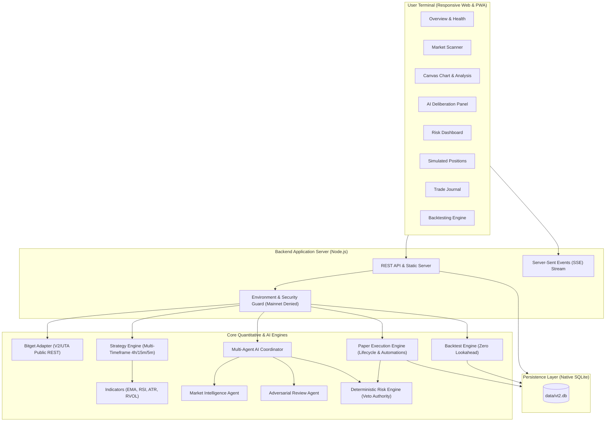

# VT2 Architecture Overview

**Tagline:** Think. Verify. Trade.

VT2 (Verifiable Trading Technology) is a high-performance quantitative trading terminal built with deterministic risk controls, multi-agent AI deliberation, and strict execution isolation.

## System Components

1. **Frontend Terminal (`public/`)**:
   - Zero-build modern ES modules.
   - High-DPI interactive Canvas candlestick and indicators chart.
   - Real-time updates via Server-Sent Events (`/api/stream`).
   - PWA installable manifest and service worker shell.

2. **Backend Server (`src/vt2-server.js`)**:
   - Modular HTTP server using Node.js native runtime.
   - Strict mainnet interception guard denying live order attempts.
   - Background ticker simulating realistic order fills and stop tracking.

3. **Bitget Market Data Adapter (`src/adapters/bitget-adapter.js`)**:
   - Official Bitget UTA / V2 REST endpoints for contracts, tickers, and candles.
   - Verified fallback mode with transparent labeling when live external feeds are unreachable or restricted.

4. **Deterministic Risk Engine (`src/risk-engine.js`)**:
   - Sole authority over paper trade permissions.
   - Absolute veto power over all AI agent trade recommendations.

5. **Multi-Agent Deliberation Coordinator (`src/agents/index.js`)**:
   - 3-tier synthesis: Market Intelligence -> Adversarial Review -> Risk Engine.
   - Rules-only fallback mode when no external LLM API key is present.

6. **Durable Persistence (`src/storage/db.js`)**:
   - Built on Node.js v26 native `node:sqlite` (`DatabaseSync`).
   - Durable file-based SQLite database (`data/vt2.db`) surviving application restarts.
